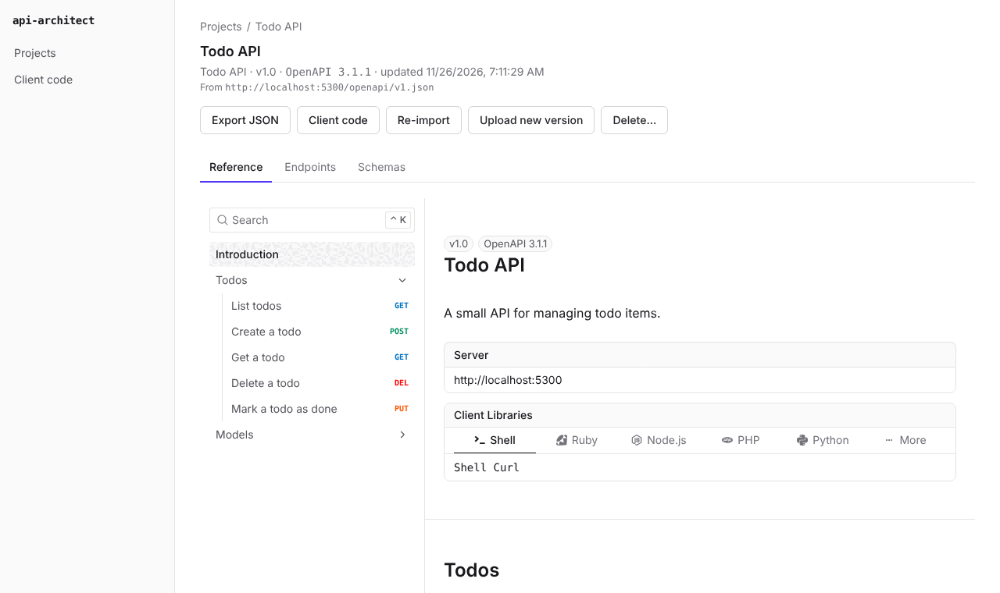
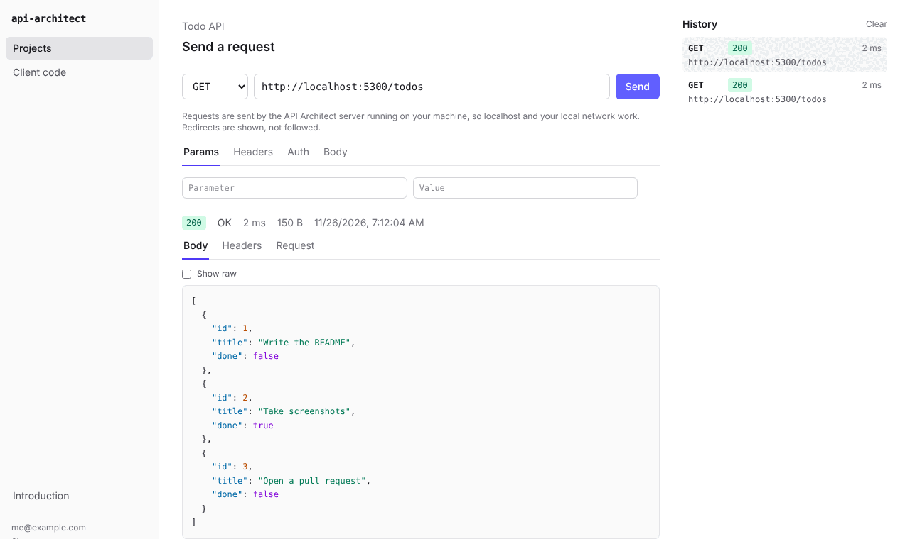
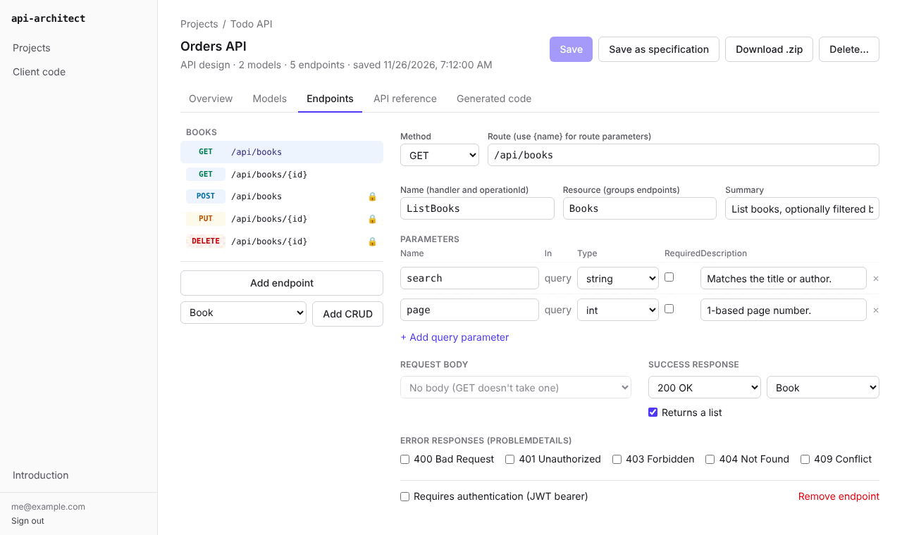
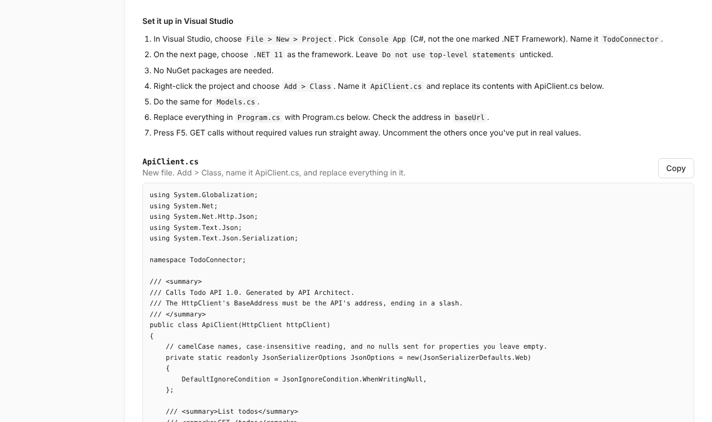

# API Architect

A local tool for working with your own APIs. Import an OpenAPI spec and read it as docs, send requests to the API
(including ones running on localhost), save them in collections, design a new API and download it as a .NET 11
project, or get C# client code to call an API from Visual Studio.

It runs on your machine only, for one user. No cloud services.



Send requests and see the response. They go out from the app on your machine, so localhost works.



Design an API's models and endpoints, then check the generated reference and code.



Get a C# connector or worker for an imported API, with the steps to set it up in Visual Studio.



## Requirements

- .NET SDK 11
- Node.js 22
- Docker (only for PostgreSQL)

## Set up

```bash
docker compose up -d                      # PostgreSQL on 127.0.0.1:5432
dotnet dev-certs https --trust            # first time only
cd web && npm install && npm run build && cd ..
dotnet run --project src/ApiArchitect.Api --launch-profile https
```

Open https://localhost:7149 and register. The database is created on first start, and a short tour shows you around.

To stop, press Ctrl+C and run `docker compose down`. Your data stays in the `pgdata` volume (`down -v` deletes it).
Run `npm run build` in `web/` again after pulling front-end changes.

The app runs outside Docker on purpose, so it can reach APIs on your localhost.

## Importing your own API

If your ASP.NET Core API calls `AddOpenApi()` and `MapOpenApi()`, its spec is at `/openapi/v1.json`. Use Import API
on the Projects page with that URL. Re-import on the spec page pulls the latest version and shows what changed.

## Settings

In `src/ApiArchitect.Api/appsettings*.json`, or override with `dotnet user-secrets` or environment variables.

| Setting | Default | |
| --- | --- | --- |
| `ConnectionStrings:Database` | localhost, user and password `postgres` | Matches `docker-compose.yml` |
| `Execution:AllowPrivateNetworks` | `true` | Lets requests reach localhost and your LAN. Set to `false` if anyone else can reach the app. |
| `Execution:TimeoutSeconds` | `30` | Per request |
| `Execution:MaxResponseBytes` | 5 MB | Larger responses are cut off |

Cloud metadata addresses such as 169.254.169.254 are always blocked, and redirects are shown, not followed.

Environment secrets are encrypted with ASP.NET Core Data Protection, whose keys live in your user profile
(`~/.aspnet/DataProtection-Keys`, or `%LOCALAPPDATA%\ASP.NET\DataProtection-Keys` on Windows). If you delete them,
saved secrets have to be entered again.

## Develop

```bash
cd web && npm run dev       # http://localhost:5173, proxies /api to the running app
dotnet test                 # needs the Docker database running
```

Tests use a real PostgreSQL database, created and dropped per run. Set `TEST_DATABASE` to use another server.

After changing entities, add a migration:

```bash
dotnet tool restore
dotnet ef migrations add <Name> --project src/ApiArchitect.Api --output-dir Data/Migrations
```
